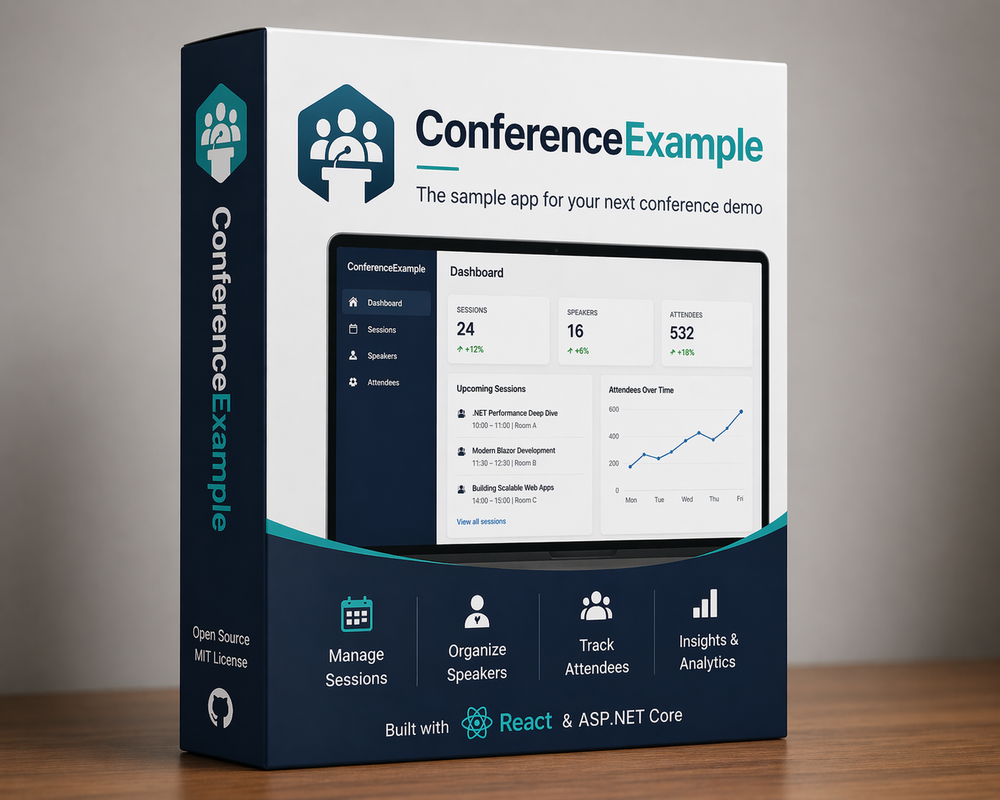

# ConferenceExample

This is an example which I use in some of my conference talks: a conference management
system built with **.NET 10 / ASP.NET Core** (Clean Architecture, DDD, Event Sourcing, CQRS)
and a **React / TypeScript** frontend.



## ⚠️ Disclaimer

**This is an example project for demonstration and educational purposes only.** It is **not production-ready** and has **not been reviewed for security concerns**. Do not use this code in production environments without thorough review, testing, and security hardening.

## Overview

Speakers maintain a profile, manage their talks and submit them to conferences. Organizers run
conferences: they define talk types and rooms, receive and decide on submissions and schedule
the accepted talks.

### Bounded contexts

| Context        | Responsibility                                                              |
|----------------|-----------------------------------------------------------------------------|
| **Speaker**    | Speaker profiles (name, biography)                                          |
| **Talk**       | A speaker's talks (create, edit, delete) and their submissions to conferences |
| **Conference** | Conferences, talk types, rooms, schedule/program, handling of submissions   |

Authentication is currently a simple self-built construct (`ConferenceExample.Authentication`),
not a bounded context. Contexts communicate via domain events published on an in-process event
bus; further contexts (Voting, Notification, Attendee, Content) are planned in the
[architecture documentation](https://andreaslausen.github.io/ConferenceExample/) but not
implemented yet.

### Technology

- **Backend:** .NET 10, ASP.NET Core Web API, event sourcing on **MongoDB** (replica set),
  in-process event bus, OpenAPI
- **Frontend:** React, TypeScript, Vite, Tailwind CSS v4, shadcn/ui
- **Tests:** xUnit + NSubstitute (Domain unit tests, 100% coverage and mutation score via
  Stryker), Reqnroll/Gherkin acceptance tests against the REST API with Testcontainers,
  architecture tests
- **Tooling:** CSharpier, git pre-commit hook, GitHub Actions

### Repository layout

```
src/backend/
  API/               ASP.NET Core entry point (ConferenceExample.API)
  Speaker/           Domain, Application, Persistence (+ Domain.UnitTests)
  Talk/              Domain, Application, Persistence (+ Domain.UnitTests)
  Conference/        Domain, Application, Persistence (+ Domain.UnitTests)
  Infrastructure/    Authentication, EventStore
  Tests/             AcceptanceTests, ArchitectureTests
src/frontend/        React + TypeScript app
src/documentation/   arc42 architecture documentation (AsciiDoc)
scripts/             Local dev infrastructure and mutation test scripts
docs/                Generated documentation (GitHub Pages)
.agents/             Guidance for AI coding agents (see AGENTS.md)
```

## Getting Started

### Prerequisites

- [.NET 10 SDK](https://dotnet.microsoft.com/download)
- [Docker](https://www.docker.com/) (MongoDB for local development, acceptance tests, documentation build)
- [Node.js](https://nodejs.org/) v20 or later (e.g. via [nvm](https://github.com/nvm-sh/nvm))

### One-time setup

After cloning the repository, run:

```bash
./init-hooks.sh
```

This will:
- Register the `.githooks` directory so git picks up the pre-commit hook
- Install [CSharpier](https://csharpier.com/) as a local dotnet tool if not already present

The pre-commit hook automatically formats all staged C# files with CSharpier and regenerates the
architecture documentation when `.adoc` files are staged. **The hook must be active** to ensure
consistent formatting; don't bypass it.

### Run the application

```bash
# 1. Start MongoDB (replica set) and Mongo Express
./scripts/dev-start.sh

# 2. Start the backend (http://localhost:5185)
dotnet run --project src/backend/API/ConferenceExample.API

# 3. Start the frontend (http://localhost:5173)
cd src/frontend
npm install     # once
npm run dev
```

The frontend proxies `/api/*` requests to the backend at `http://localhost:5185`.

### Local infrastructure

```bash
./scripts/dev-start.sh   # Start MongoDB and all dev services
./scripts/dev-stop.sh    # Stop all dev services (keeps data)
./scripts/dev-reset.sh   # Reset all dev services (deletes all data!)
```

- MongoDB: `mongodb://localhost:27017` (database `conference_example`)
- Mongo Express UI: http://localhost:8081

See [scripts/README.md](scripts/README.md) for script details and
[docs/mongodb-setup.md](docs/mongodb-setup.md) for configuration and production considerations.

## Backend

```bash
dotnet build                                          # Build (src/backend/ConferenceExample.sln)
dotnet test                                           # Run all tests (acceptance tests need Docker)
dotnet test src/backend/Tests/ConferenceExample.AcceptanceTests   # Acceptance tests only
dotnet csharpier .                                    # Format code
./scripts/run-mutation-tests.sh                       # Mutation tests for the Domain projects
```

Test strategy:
- **Unit tests** exist for the Domain layer only (100% coverage and mutation score required).
- Everything else is covered by **Gherkin acceptance tests** that call the REST API over HTTP
  against a MongoDB Testcontainer.
- **Architecture tests** enforce layer dependency and CQRS/event-sourcing rules.

`TreatWarningsAsErrors` and nullable reference types are enabled project-wide.

## Frontend

The frontend lives in [src/frontend/](src/frontend/).

```bash
cd src/frontend
npm run dev            # Dev server at http://localhost:5173
npm run build          # Type-check and build for production
npm run lint           # Run ESLint
npm run generate-api   # Regenerate TypeScript types from openapi.json
```

### API type generation

The frontend uses TypeScript types generated from the backend's OpenAPI spec. `openapi.json` is
regenerated at the repo root automatically whenever the backend is built. After backend API
changes:

```bash
dotnet build src/backend/ConferenceExample.sln   # Regenerates openapi.json
cd src/frontend && npm run generate-api
```

## Architecture Documentation

The architecture documentation follows the [arc42](https://arc42.org/) template and is written in
AsciiDoc. The sources are in [src/documentation/](src/documentation/).

The published documentation is available at: **https://andreaslausen.github.io/ConferenceExample/**

To build it locally (requires Docker):

```bash
./build-docs.sh
```

This renders the AsciiDoc sources into `docs/index.html`, processes embedded diagrams with
[Asciidoctor Diagram](https://docs.asciidoctor.org/diagram-extension/latest/) and copies the
generated images to `docs/images/`. Committing changes to `docs/` updates the GitHub Pages site.

## Continuous Integration

GitHub Actions workflows in [.github/workflows/](.github/workflows/):

- `backend-ci` and `frontend-ci` run automatically on pull requests (path-filtered to
  `src/backend/**` and `src/frontend/**`).
- `backend-architecture-tests` and `backend-acceptance-tests` are triggered manually
  (`workflow_dispatch`) to save CI cost.

## Working with AI coding agents

Guidance for AI coding agents (Claude Code, Codex, Cursor, ...) is in [AGENTS.md](AGENTS.md)
and the topic files in [.agents/](.agents/).

## License

See [LICENSE](LICENSE).
